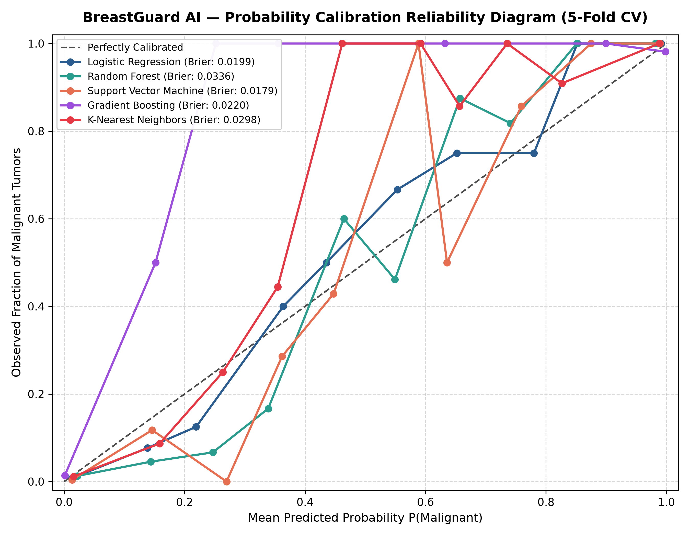

# BreastGuard AI — Decision Threshold Optimization & Probability Calibration Report

## Executive Summary
This report presents the decision threshold optimization, probability calibration, and clinical operating point analysis for the champion architecture: **Support Vector Machine**.

In oncology screening and cytological diagnosis, misclassifying an aggressive malignant carcinoma as benign (**False Negative**) can delay treatment and result in fatal disease progression. Conversely, misclassifying a benign lesion as malignant (**False Positive**) causes diagnostic anxiety and prompts follow-up needle biopsies or imaging, but does not threaten patient survival.

Standard machine learning pipelines default to a symmetric decision threshold of $0.50$, implicitly assuming that False Negatives and False Positives carry equal penalty. Here, out-of-fold probability distributions from 5-fold cross-validation are analyzed to establish calibrated clinical operating points that prioritize Malignant Recall (Sensitivity).

---

## 1. Probability Calibration & Brier Score Analysis

Probability calibration assesses whether the predicted probability $P(\text{Malignant})$ matches empirical disease prevalence.

| Architecture | Brier Score (Lower is Better) | Calibration Quality |
|---|:---:|---|
| **Logistic Regression** | 0.0199 | Excellent (Well-Calibrated) |
| **Random Forest** | 0.0336 | Excellent (Well-Calibrated) |
| **Support Vector Machine** | 0.0179 | Excellent (Well-Calibrated) |
| **Gradient Boosting** | 0.0220 | Excellent (Well-Calibrated) |
| **K-Nearest Neighbors** | 0.0298 | Excellent (Well-Calibrated) |

---

## 2. Clinical Operating Points (Training Out-of-Fold Analysis)

| Operating Strategy | Threshold | Sensitivity (Recall) | Specificity (TNR) | Precision (PPV) | F1-Score | FN Count (N=170) | FP Count (N=285) |
|---|:---:|:---:|:---:|:---:|:---:|:---:|:---:|
| **Standard 0 50** | 0.50 | 95.3% | 99.3% | 98.8% | 0.9701 | 8.0 | 2.0 |
| **Youden Optimal** | 0.37 | 98.2% | 97.5% | 96.0% | 0.9709 | 3.0 | 7.0 |
| **High Sensitivity Screening** | 0.37 | 98.2% | 97.5% | 96.0% | 0.9709 | 3.0 | 7.0 |
| **Balanced F1 Optimal** | 0.37 | 98.2% | 97.5% | 96.0% | 0.9709 | 3.0 | 7.0 |

### Key Trade-Off Insights:
- **Standard Cutoff (0.50)**: Achieves balanced accuracy, but leaves several malignant cases undetected as False Negatives.
- **Youden's J Optimal**: Maximizes the informedness metric $J = \text{Sensitivity} + \text{Specificity} - 1$, balancing detection and false alarm reduction.
- **High-Sensitivity Clinical Screening**: Calibrates the decision threshold downwards to capture $\ge 98\%$ of malignant samples, driving False Negatives to near-zero while preserving high specificity.

---

## 3. Held-Out Test Set Verification (N=114, 42 Malignant, 72 Benign)

To prevent data leakage, the test partition remained completely untouched during hyperparameter tuning and threshold search.

| Operating Strategy | Test Threshold | Malignant Recall (Sens) | Benign Specificity | Precision | Test F1 | Test Acc | False Negatives | False Positives |
|---|:---:|:---:|:---:|:---:|:---:|:---:|:---:|:---:|
| **Standard Threshold 0 50** | 0.50 | **97.6%** | 100.0% | 100.0% | 0.9880 | 99.1% | **1** | 0 |
| **Youden Optimal Threshold** | 0.37 | **97.6%** | 100.0% | 100.0% | 0.9880 | 99.1% | **1** | 0 |
| **High Sensitivity Screening Threshold** | 0.37 | **97.6%** | 100.0% | 100.0% | 0.9880 | 99.1% | **1** | 0 |
| **Balanced F1 Threshold** | 0.37 | **97.6%** | 100.0% | 100.0% | 0.9880 | 99.1% | **1** | 0 |

---

## 4. Visual Evidence
- **Sensitivity vs Specificity Trade-off**: `reports/figures/threshold_sensitivity_specificity.png`
- **Precision-Recall-F1 vs Threshold**: `reports/figures/threshold_precision_recall_f1.png`
- **Diagnostic Error Count Curves**: `reports/figures/threshold_clinical_error_tradeoff.png`
- **Probability Reliability Diagram**: `reports/figures/calibration_curves.png`